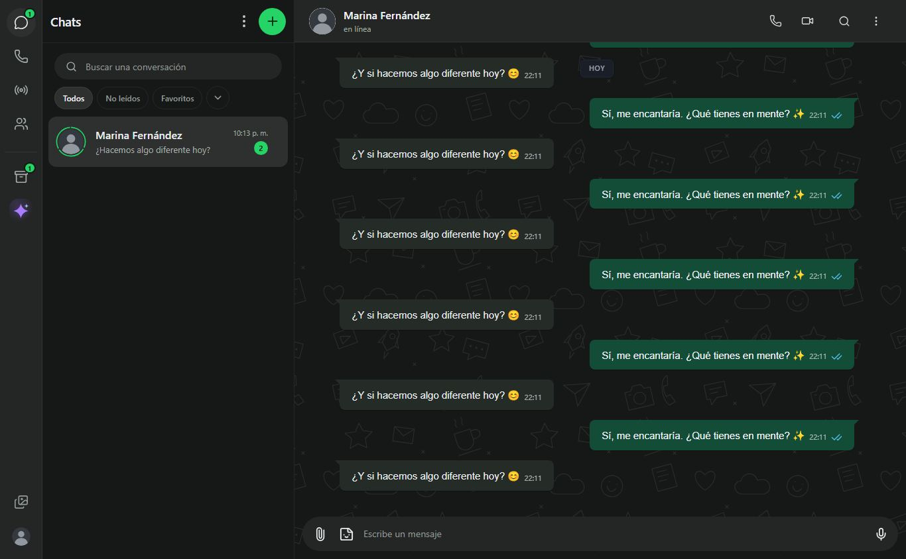

<div align="center">


# Nexus Chat

**Tus conversaciones, en un solo lugar.**

Mensajería, llamadas y comunidad desde el navegador.<br />
Una interfaz adaptable a móvil, tablet y computadora.

[](https://nexus-chat-nc.web.app/)
[](package.json)
[](tsconfig.json)
[](firebase.json)


[](docs/CIFRADO-Y-LLAMADAS.md)
[](#-el-proyecto)
[](#ajustes-de-conversación-y-voz)
[](#-el-proyecto)
[](docs/DISENO-RESPONSIVE.md)
[](#-comandos)
[](#-configuración)
[](docs/INDICE.md)

[](https://github.com/Josxe155/Nexus-Chat/actions/workflows/check.yml)


[Ver la web](https://nexus-chat-nc.web.app/) · [Instalación](#-inicio-rápido) · [Configuración](#-configuración) · [Documentación](#-documentación)

El código de AdSense se carga en la [guía pública](https://nexus-chat-nc.web.app/guia.html). La portada incluye la metaetiqueta para verificar la propiedad del sitio. El archivo de vendedores autorizados se publica en [ads.txt](https://nexus-chat-nc.web.app/ads.txt).

</div>

---

## ✨ El proyecto

Nexus Chat reúne conversaciones, archivos, estados, comunidades y llamadas en una aplicación web con identidad propia. Utiliza **React + TypeScript** para la interfaz y **Firebase** para autenticación, datos y publicación.

| 💬 Conversaciones | 📞 Voz y video | 🌐 En cualquier pantalla |
| :--- | :--- | :--- |
| Chats personales y grupos, respuestas, reacciones y mensajes destacados. | Llamadas con WebRTC y Metered como relé TURN cuando se necesita. | Interfaz adaptable a computadora, tablet y celular, directamente en el navegador. |

| 📎 Archivos y audio | 🟢 Estados y comunidad | 🤖 Nexus AI |
| :--- | :--- | :--- |
| Fotos, videos, documentos, notas de voz y visualización de archivos. | Estados, comunidades y controles de privacidad. La categoría de canales está retirada. | Asistente con Groq y OpenRouter; creación de imágenes con Pollinations. |

> [!NOTE]
> Es un proyecto en desarrollo. Las funciones dependen de los permisos del navegador, la conexión y las cuotas de los proveedores. El alcance y las diferencias pendientes se describen en [PENDIENTES-WHATSAPP.md](docs/PENDIENTES-WHATSAPP.md).

## Vista previa

Capturas de la aplicación con **datos ficticios de demostración**. No incluyen conversaciones ni fotos personales del propietario.



| Grabación activa | Grabación pausada y preescucha |
| --- | --- |
|  |  |

## 🎞️ Expresiones en Nexus Web

| GIFs · GIPHY | Stickers · KLIPY | Visor de stickers |
| :--- | :--- | :--- |
| Búsqueda por categorías y cuadrícula de resultados animados. | Cuadrícula de cinco columnas, búsqueda y acceso a crear stickers. | Vista amplia con remitente, fecha y acciones del mensaje. |
| Seleccionar abre una revisión con comentario y miniatura; se envía al pulsar la flecha. | Los favoritos guardados se encuentran en la pestaña visible Favoritos de este navegador. | Responder, destacar, fijar cuando hay permiso, eliminar y reenviar. El sticker se amplía desde el chat al abrirlo. Añadir o quitar favoritos vuelve al chat con una transición, sin mensajes de confirmación; respeta movimiento reducido. |

Esta distribución es exclusiva de computadora. Nexus Messenger conserva sus pantallas móviles. Se usan los datos reales del chat y del proveedor; no se inventan nombres de paquetes de stickers.

## ⚙️ Ajustes en celular

La vista de celular reúne Apariencia, Privacidad, Chats, Notificaciones, Almacenamiento y datos, Accesibilidad y Ayuda y comentarios en pantallas y diálogos adaptados al ancho del teléfono. Los colores, los iconos de pestaña y el horario de enfoque están disponibles sin suscripción.

Las opciones de descarga usan el perfil de red cuando el navegador lo informa y la regla general en los demás casos. La vibración, el límite de datos de llamadas y el icono de pestaña dependen de las funciones admitidas por el navegador. «Liberar espacio» administra copias de archivos guardadas localmente. El historial permite exportar, archivar, vaciar o quitar conversaciones del historial propio.

## 📞 Llamadas y avisos en el navegador

Las llamadas directas dan un margen de 18 segundos para que vuelva un participante que se desconecta de la señalización. Si la conexión vuelve, Nexus vuelve a registrar su presencia y reintenta restablecer la comunicación cuando hace falta. El cambio entre cámaras conserva o restaura la anterior si la otra no se puede abrir.

Cuando las vistas previas están desactivadas, los avisos de mensajes usan el nombre de Nexus y un texto genérico. Los avisos de llamada pueden volver a la pestaña que está recibiendo la llamada. Los avisos dependen de los permisos del navegador y de que Nexus siga ejecutándose.

## 🔒 Visualización única y mensajes temporales

En Nexus Messenger puedes marcar una foto o un video individual para **visualización única** desde la revisión del archivo. La apertura se registra por cuenta. El archivo queda fuera del visor normal, la galería, el reenvío y la exportación de chats. El navegador todavía permite capturar el contenido mientras se muestra.

Si otra persona quiere conservar un mensaje temporal, Nexus envía una solicitud dentro del chat. La caducidad sigue corriendo hasta que el remitente apruebe. Si rechaza la solicitud o revoca lo que otra persona conservó, queda bloqueada una nueva solicitud para ese mensaje.

## 📣 Nexus Chat Oficial

En celulares, **Nexus Chat Oficial** aparece en la lista de conversaciones con una insignia propia. El chat es de solo lectura y muestra los últimos 50 avisos. Al abrirlo se guardan en la cuenta los avisos leídos.

El panel privado [`/dashboard.html`](https://nexus-chat-nc.web.app/dashboard.html) permite publicar y retirar novedades, avisos del servicio y recomendaciones de seguridad. Firestore comprueba que quien publica o retira tenga autorización de administración. Los avisos llegan a Nexus Chat Oficial en celular, tablet y computadora y aparecen en tiempo real mientras la página está abierta.

El **Dashboard · Nexus Chat** organiza el panel en Resumen, Reportes, Avisos, Mantenimiento, Informes y Nexus Assistant. Permite consultar recuentos de actividad y almacenamiento, revisar reportes de mensajes y descargar un informe en HTML o escucharlo en español. La lectura se sintetiza en el navegador con [meSpeak y eSpeak](https://www.masswerk.at/mespeak/) ([GPL y fuentes](https://nexus-chat-nc.web.app/voices-license.txt)), sin enviar el texto a un servicio de voz. Para redactarlo, Nexus AI recibe cifras agregadas, fechas y el estado del plan mensual. El informe también se puede preparar directamente a partir de esas cifras. Nexus Assistant utiliza Gemini y consulta los datos de Nexus desde una conversación privada del dashboard. Puede preparar creaciones, actualizaciones y eliminaciones en Firestore y Realtime Database, planificar limpiezas y ejecutar órdenes directas o propuestas confirmadas por texto. Las autorizaciones de administración y los registros de auditoría permanecen protegidos. El historial del asistente se guarda únicamente en este navegador. La clave se define en la configuración local de servicios que se usa al compilar Hosting. El repositorio mantiene la plantilla sin credenciales. La barra inferior de Nexus Assistant incluye lectura local en español, sin depender de las voces instaladas del navegador. El bloqueo de aplicación se configura desde Privacidad y se aplica en ese navegador. El historial se consulta por páginas. La edición administrativa se aplica mediante comandos comprobados y conserva el registro del texto anterior. Las tarjetas abren listas paginadas y la gráfica permite consultar cada fecha en hora de Ecuador. Reportes separa mensajes de contactos, grupos y canales. Mantenimiento controla el aviso público y permite ejecutar una limpieza inmediata con confirmación sin mover la fecha del plan mensual.

## 🧩 Tecnología

| Capa | Tecnología | Función |
| :--- | :--- | :--- |
| Interfaz | React 18 · TypeScript · Vite | Componentes, navegación y compilación. |
| Acceso | Firebase Authentication | Inicio de sesión y recuperación de cuentas. |
| Conversaciones | Cloud Firestore | Perfiles, chats, mensajes, preferencias y permisos. |
| Tiempo real | Firebase Realtime Database | Presencia, señalización y archivos fragmentados. |
| Publicación | Firebase Hosting | Entrega de la web mediante HTTPS. |
| Llamadas | WebRTC · Metered | Comunicación de voz y video; relé TURN. |
| Inteligencia artificial | Groq · OpenRouter | Asistente y procesamiento de las solicitudes autorizadas. |

**La web no necesita un servidor Node.js propio en producción.** El panel privado `/dashboard.html` ejecuta acciones directamente con Firebase desde el navegador autorizado; no usa GitHub Actions ni un servidor externo.

## 🚀 Inicio rápido

**Requisitos:** Node.js 22 o posterior, npm y Git.

```sh
git clone https://github.com/Josxe155/Nexus-Chat.git
cd Nexus-Chat
npm ci
npm run dev
```

Abre **http://localhost:3000**.

La instalación crea `src/public-services.json` desde la plantilla si el archivo todavía no existe. Si instalaste con los scripts deshabilitados, ejecuta `npm run setup`.

## ⚙️ Configuración

| Archivo | Qué debes configurar | ¿Se sube a Git? |
| :--- | :--- | :---: |
| `src/public-services.json` | Claves de Gemini (dashboard), Groq, OpenRouter, Metered, GIPHY, KLIPY y Pollinations. | **No** |
| `src/public-services.example.json` | Plantilla sin claves para crear la configuración local. | Sí |
| `firebase-applet-config.json` | Identificadores públicos de tu proyecto Firebase. | Sí |
| `.firebaserc` · `firebase.json` | Proyecto de destino y sitio de Hosting. | Sí |
| `firestore.rules` · `database.rules.json` | Permisos de acceso a los datos. | Sí |

<details>
<summary><strong>Configurar IA, transcripción y llamadas</strong></summary>

Para GIFs y stickers configura también `giphyKey` y `klipyKey`. Los paquetes predeterminados se retiraron.

Completa los campos de `src/public-services.json` con tus propias claves y los datos del proveedor. Sin esa configuración, la copia puede compilar, pero las funciones que dependen de esos servicios no estarán plenamente disponibles.

- **Groq:** asistente y transcripción de audio.
- **OpenRouter:** alternativa para el asistente.
- **Metered:** credenciales TURN para mejorar la conectividad de las llamadas.

Excluir las claves de Git **no las oculta en la web compilada**: cualquier clave utilizada desde el navegador puede extraerse de los archivos o de las solicitudes de la aplicación.

</details>

<details>
<summary><strong>Usar un proyecto Firebase diferente</strong></summary>

El repositorio contiene los identificadores públicos del proyecto Nexus existente. Para publicar una copia independiente, reemplaza:

1. La configuración de `firebase-applet-config.json`.
2. El proyecto de `.firebaserc`.
3. El sitio de Hosting de `firebase.json`.

Configura los proveedores de Authentication, los dominios autorizados, las reglas y los índices en tu propio proyecto. Publicar en el proyecto existente requiere una cuenta autorizada.

</details>

## 🛠️ Comandos

| Comando | Acción |
| :--- | :--- |
| `npm ci` | Instala las dependencias del archivo de bloqueo y prepara la configuración local. |
| `npm run setup` | Crea la configuración local si todavía no existe. |
| `npm run dev` | Inicia la web de desarrollo en el puerto 3000. |
| `npm run lint` | Comprueba los tipos de TypeScript. |
| `npm run build:hosting` | Compila la web y genera el manifiesto de actualización. |
| `npm run preview` | Permite revisar una compilación local. |

La corrección **v26.79.3** retira la entrada por voz de Nexus AI y Nexus Assistant. La corrección **v26.79.2** amplía las consultas y respuestas de Nexus Assistant a 500 líneas, continúa automáticamente las respuestas incompletas y mejora la lectura larga en español. La versión **v26.79.0** incorpora Nexus Assistant con historial local, dictado por sesión, avisos de tres segundos y herramientas generales de administración mediante órdenes y propuestas por texto. La corrección **v26.78.1** conserva las comillas y los símbolos incompletos y corrige la negrita y el código en chats y respuestas de IA. La versión **v26.78.0** convierte Modo IA en un chat sencillo, añade comandos de edición con auditoría y síntesis local en español. La revisión **v26.76.2** migra el Modo IA del dashboard a Gemini, permite usar las voces en español del sistema y renueva el logo y los favicons. El asistente general mantiene OpenRouter como alternativa. Consulta [la preparación y verificación en Codex Cloud](docs/CODEX-CLOUD.md) para conocer las pruebas y los accesos pendientes.

## ☁️ Publicación en Firebase

```sh
npm run lint
npm run build:hosting
npx firebase-tools login
npx firebase-tools deploy --only hosting,firestore:rules,firestore:indexes,database --project nexus-chat-56d9d
```

El sitio publicado es **[nexus-chat-nc.web.app](https://nexus-chat-nc.web.app/)**. La carpeta generada es `dist/`; sus archivos y las dependencias no se versionan.

### Versión de la web

**Ajustes → Acerca de la web** muestra la versión que está abierta en el navegador y permite buscar actualizaciones. Se define en [src/webVersion.json](src/webVersion.json), y la compilación la incluye en `release.json` junto con su identificador técnico.

La numeración de 2026 empieza en `26.1`. Se contaron 73 versiones distintas publicadas en el canal público de Nexus Chat hasta el 8 de noviembre de 2026, antes de esta entrega `26.74`. Sube el segundo número con cada nueva implementación pública. Usa un tercer número para una corrección de la versión en curso, como `26.74.1`. Los despliegues de prueba quedan fuera.

La versión **26.75** renueva la portada móvil de Ajustes, añade búsqueda y organiza el perfil, la foto y la sección Info. Desde el botón QR se puede compartir un contacto de Nexus, escanearlo con la cámara o galería y sustituir el código anterior. Las funciones de QR de contacto requieren sesión y conexión. Los enlaces de Nexus abren una confirmación antes de iniciar un chat.

La versión **26.75.2** mantiene separadas la privacidad y la edición de Info. El editor respeta la caducidad y un QR que se restablece en otra sesión se reemplaza en la pantalla abierta. Al aplicar mensajes temporales se muestran los chats que permiten ese cambio.

Consulta el procedimiento completo en [INSTRUCCIONES-FIREBASE-HOSTING.md](docs/INSTRUCCIONES-FIREBASE-HOSTING.md).

## 🔐 Privacidad y alcance

| Aspecto | Estado actual |
| :--- | :--- |
| Transporte | HTTPS para la web y las conexiones con Firebase. |
| Acceso a conversaciones | Reglas de Firebase que restringen el acceso a sus participantes. |
| Mensajes y archivos nuevos | **Sin cifrado de extremo a extremo. Firebase puede acceder a su contenido.** |
| Historial cifrado anterior | Se conserva su lector y la importación/exportación de copias. Requiere sus claves originales. |
| Cámara y micrófono | Requieren permisos y un contexto seguro del navegador. |
| Instalación y vinculación | No se ofrece instalación como aplicación ni vinculación multidispositivo. |
| Repositorio | Sin claves de proveedores, cuentas de servicio ni datos de usuarios. |

La pérdida de las claves originales del historial cifrado anterior no permite reconstruir su contenido. Consulta [CIFRADO-Y-LLAMADAS.md](docs/CIFRADO-Y-LLAMADAS.md) para conocer el modelo de seguridad vigente.

## 📂 Estructura

```text
Nexus-Chat/
├── .github/workflows/             Comprobaciones de TypeScript y compilación
├── assents/                       Recursos gráficos del proyecto
├── docs/                          Guías, revisiones e índice de documentación
├── public/                        Iconos, emojis, sonidos y archivos estáticos
├── scripts/                       Desarrollo, configuración y compilación
├── src/                           Interfaz y lógica de la aplicación
│   └── public-services.example.json
├── firebase-applet-config.json    Configuración pública de Firebase
├── firebase.json                  Configuración de Hosting y servicios
├── firestore.rules               Reglas de Firestore
├── firestore.indexes.json         Índices de consultas
├── database.rules.json            Reglas de Realtime Database
└── package.json                   Dependencias y comandos
```

## 📚 Documentación

| Guía | Contenido |
| :--- | :--- |
| [Panel de acciones](docs/DASHBOARD.md) | Google o contraseña de la misma identidad, estadísticas, limpieza mensual y acciones locales sin backend. |
| [Referencias de GIFs y stickers](docs/GIFS-STICKERS-ESCRITORIO.md) | Revisión de envío, cuadrículas y visor de stickers en computadora. |
| [GIFs y stickers](docs/GIPHY-Y-KLIPY.md) | GIFs con GIPHY y stickers con KLIPY; configuración y cuotas. |
| [Móvil y proveedores](docs/SEGUIMIENTO-MOVIL-Y-PROVEEDORES.md) | Envíos consecutivos, teclado, emojis, actualización manual y claves de GIFs. |
| [Interfaz de escritorio](docs/REFERENCIA-ESCRITORIO-ADJUNTOS.md) | Vistas de adjuntos, selectores, formularios y separación de dispositivos. |
| [Publicar la web](docs/INSTRUCCIONES-FIREBASE-HOSTING.md) | Preparación y despliegue en Firebase. |
| [Estado de las funciones](docs/ESTADO-FUNCIONES.md) | Funciones y condiciones de la entrega. |
| [Seguridad y llamadas](docs/CIFRADO-Y-LLAMADAS.md) | Protección de datos, historial y comunicaciones. |
| [Actualizaciones y errores](docs/ACTUALIZACIONES-Y-ERRORES.md) | Actualización manual y pantallas de error. |
| [Alcance y pendientes](docs/PENDIENTES-WHATSAPP.md) | Diferencias, limitaciones y trabajo pendiente. |
| [Referencias de interfaz](docs/REVISION-REFERENCIAS-WHATSAPP.md) | Referencias consultadas para la experiencia de uso. |

## 🔄 Mantenimiento

| Estabilidad | Comportamiento |
| --- | --- |
| Actualizaciones | Descarga manual con bytes medidos, pausa, guardado local y continuación. Aviso persistente en móvil y computadora; también accesible desde Ajustes → Chats. |
| Limpieza mensual | Plan activable desde el [dashboard](docs/DASHBOARD.md), con revisión previa y aviso visible únicamente en los tres días anteriores. Requiere el panel abierto; conserva cuentas, perfiles y grupos. No se activa hasta que el propietario lo elija. |
| Rendimiento | Las ondas de audio se calculan al acercarse a la pantalla; los audios inactivos evitan renders en cada avance de reproducción. |
| GIF y stickers | Búsquedas con tiempo de espera; favoritos locales con recuperación de registros válidos. |


Los cambios de Nexus Chat se guardan también en este repositorio. GitHub Actions ejecuta las comprobaciones de TypeScript y compilación en cada subida y pull request. **Esto no publica automáticamente en Firebase.**

---

<div align="center">

**Nexus Chat** · Conversaciones con identidad propia.

Proyecto independiente, sin afiliación con WhatsApp ni Meta.<br />
Las licencias de terceros incluidas con los recursos deben conservarse.

</div>

## Experiencia actual

### Ajustes de conversación y voz

Menús propios para escritorio y móvil, selección de mensajes, reacciones, notas de voz con pausa y preescucha, y avisos que respetan las preferencias. En escritorio, el fondo del chat continúa detrás de las barras: el contenedor exterior es transparente y solo la cápsula lleva color.

### Acciones de mensajes

En el fondo del historial, el clic derecho permite seleccionar mensajes o cerrar el chat. Dentro de una burbuja abre las acciones de ese mensaje.

| Capacidad | Condición |
| --- | --- |
| Conservar mensajes | En móvil, los participantes pueden conservar mensajes temporales vigentes. La limpieza mensual sigue su calendario. |
| Notificaciones | Con la página ejecutándose. Los avisos nativos requieren permiso; no hay un servicio conectado para entregar push con el navegador cerrado. |
| Cámara y micrófono | Requieren autorización y un navegador compatible. |
| Comprobaciones | Tipos, compilación y enlaces locales de documentación mediante GitHub. Las pruebas visuales usan datos ficticios y micrófono simulado. |

[Historial de revisiones de interfaz](docs/HISTORIAL-INTERFAZ.md) · [Índice de documentación](docs/INDICE.md)

## Estado de la revisión móvil

Se retiran los porcentajes globales anteriores: no tenían una medición reproducible. El seguimiento distingue pruebas realizadas y límites pendientes.

| Apartado | Verificado en navegador | Pendiente |
| --- | --- | --- |
| Voz móvil | Toque para grabar con manos libres, deslizar hacia arriba para bloquear o hacia la izquierda para descartar con animación. La grabación bloqueada se elimina al instante. | Teléfonos físicos y variaciones de permisos del sistema. |
| Selección | Barra superior, franja verde, reacciones, menús propios/recibidos y selección múltiple. | Validación de uso prolongado en dispositivos físicos. |
| Mensajes nuevos | Lotes de 50, historial anterior, mensajes propios y ventana limitada de historial. | Pruebas de carga con tráfico real sostenido. |
| Permisos | Los participantes pueden conservar mensajes temporales visibles. El remitente o quien conservó el mensaje pueden restaurar su vencimiento. | La acción depende del tipo de mensaje y del acceso al historial. |
| Reportes de mensajes | El panel privado muestra el texto y los datos del mensaje seleccionado. El bloqueo del remitente es opcional. | Los reportes guardan el nombre del adjunto cuando existe. |

[Detalle de selección y voz](docs/REVISION-MOVIL-SELECCION-Y-VOZ.md) · [Contacto e identidad](docs/ACTUALIZACION-MOVIL-2026-11-06.md).

### Numeración de versiones

Nexus usa `vAA.N.C`. `AA` son los dos últimos dígitos del año, `N` identifica la actualización general de ese año y `C` cuenta sus correcciones, hasta 5. Por ejemplo, `v27.100.5` es la quinta corrección de la actualización 100 de 2027. La comprobación y descarga se abren en **Acerca de la web**.
